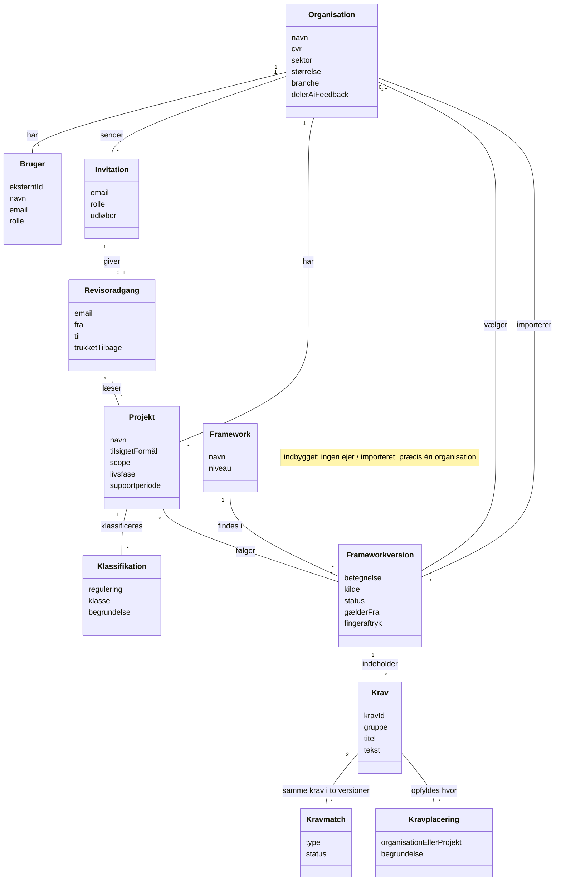
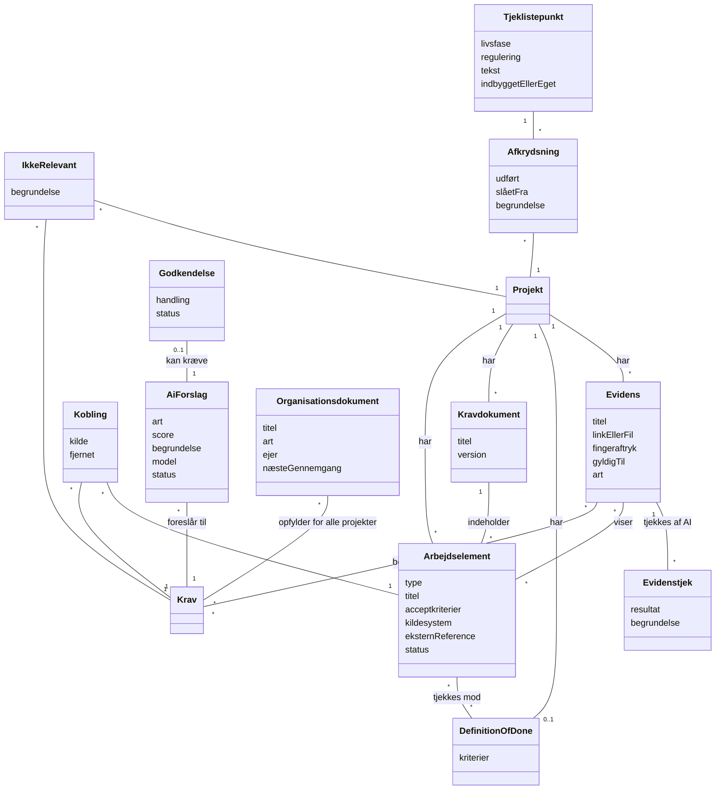
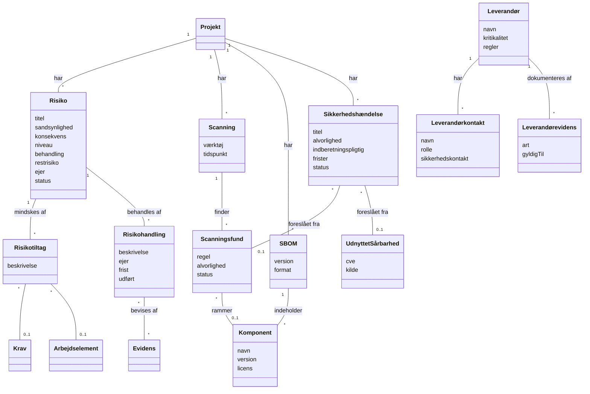
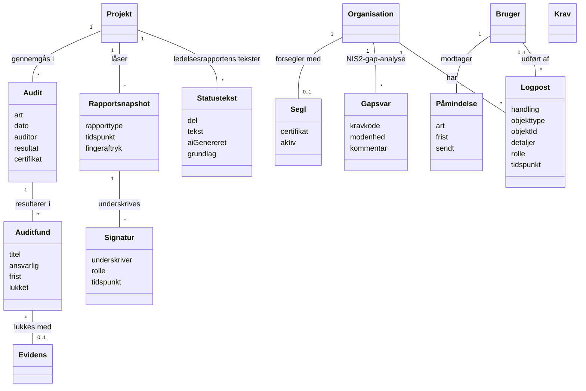
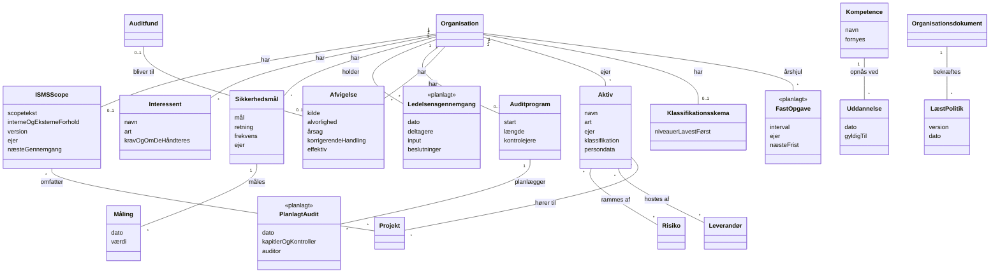

# Compliance-tracker – Domænemodel

Senest opdateret: 2026-11-25

## Formål

Domænemodellen beskriver de begreber, compliance-trackeren holder styr på, og hvordan de hænger sammen. Den er teknologineutral: ingen datatyper, metoder eller navigationsretning. Det står i [klassediagrammet](klassediagram.md), som også viser de tekniske hjælpeklasser (filer, AI-forslag pr. type, services).

Trackeren svarer på spørgsmålet *"overholder vi reglerne, og kan vi bevise det?"*. Den svarer ikke på *"hvad skal vi bygge?"*; det er udviklernes ansvar og bor i deres eget værktøj.

Se også [beslutningsloggen](beslutningslog.md) og [roadmappen](roadmap.md).

## Diagrammer

Modellen er delt i fem områder, så hvert diagram kan læses for sig. Et begreb, der findes i flere diagrammer, er det samme begreb.

### 1. Organisation, projekter og regler

### 2. Opfyldelse og bevis

### 3. Risiko og sikkerhed

### 4. Revision, rapporter og opfølgning

### 5. ISMS'et (US-208 til US-216)

Begreberne hører til organisationen, og projekterne er det, ISMS'et dækker. ISMS-scope og Interessent er bygget (US-208), og det er Aktiv og Klassifikationsskema (US-214) Afvigelse (US-212) Sikkerhedsmål med Måling (US-209) Auditprogram (US-211) og Kompetence, Uddannelse og LæstPolitik (US-213) også. De andre er besluttet som stories og markeret «planlagt».

## Begreber

| Begreb | Betydning | Story |
|---|---|---|
| Organisation | Virksomheden, der bruger trackeren. Sektor, størrelse og branche afgør bl.a., om NIS2 er relevant, og hvilke reguleringer der foreslås. | US-001, US-080 |
| Bruger | En person i organisationen med en rolle. Logger ind via Keycloak og genkendes på sit eksterne id (`sub`). | US-004, US-010 |
| Invitation | En invitation til at blive medlem med en bestemt rolle. Udløber. | US-009, US-196 |
| Revisoradgang | Tidsbegrænset læseadgang for en ekstern revisor til ét projekt, højst 30 dage, kan trækkes tilbage. | US-182 |
| Projekt | Et produkt, der skal overholde regler. Tilsigtet formål og scope afgør, hvilke krav der gælder, og er kontekst for AI'en. Har en livsfase og en supportperiode. | US-008, US-024 |
| Klassifikation | Hvordan en regulering gælder for projektet, fx "CRA: vigtig klasse I", med begrundelse. Erstattes, ændres ikke. | US-026 |
| Framework | Regelsættets navn, fx CRA, ISO 27001 eller NIS2. Niveau angiver, om det gælder organisationen eller et projekt. Indeholder ingen kravtekst. | US-005 |
| Frameworkversion | En konkret udgave af et framework. Kilden er *indbygget* (offentlig EU-lovgivning) eller *importeret* (organisationens licenserede katalog). Låst, når den er aktiv. | US-005, US-035 |
| Krav | Ét krav i en frameworkversion. ISO 27001's Annex A-kontroller er også krav. | US-007 |
| Kravmatch | At to krav i forskellige versioner eller frameworks kræver det samme, så dækning kan gå fra det ene til det andet. Foreslås af AI og godkendes af en person. | US-037, US-110 |
| Kravplacering | Om et krav opfyldes af organisationen (fx en politik) eller i hvert projekt, med begrundelse. | US-115 |
| Arbejdselement | En user story, use case eller opgave fra teamets eget værktøj (GitHub, Azure DevOps) eller et uploadet kravdokument. Trackeren ejer den ikke. | US-018, US-104 |
| Kravdokument | Et uploadet dokument med krav eller use cases, fx Word eller Excel, med versioner. | US-032, US-033, US-034 |
| Definition of Done | Projektets kriterier for, hvornår en story er færdig, og afkrydsningen pr. story. | US-109 |
| Kobling | At et arbejdselement opfylder et krav. Laves i hånden eller ved et godkendt AI-forslag. Slettes aldrig, men fjernes. | US-019, US-020 |
| Ikke relevant | At et krav ikke gælder for projektet, med begrundelse. Tæller ikke med i dækningen. | US-043 |
| Evidens | Bevis for, at et krav er opfyldt: fil eller link med fingeraftryk og evt. udløbsdato. Gemmes én gang i projektet og kobles til de krav og stories, den beviser. Er enten dokumentation eller bevis. | US-057, US-059, US-204 |
| Evidenstjek | AI'ens vurdering af, om evidensen beviser kravet, med begrundelse. | US-038 |
| Organisationsdokument | En politik, procedure eller risikotabel for hele organisationen, med versioner, som alle projekter kan bruge som evidens. | US-115, US-136 |
| AI-forslag | AI'ens forslag, fx en kobling, evidens, et risikoudkast, et story-udkast, "kræver handling" eller en sikkerhedshændelse. Gemmer model og begrundelse og skal altid besluttes af en person. | US-020, US-108, US-112, US-155 |
| Godkendelse | En handling, der venter på en anden persons godkendelse, før den sker (fire-øjne-princippet). | US-135 |
| Tjeklistepunkt | Et punkt, der skal være på plads i en livsfase for en regulering. Indbygget eller organisationens eget. | US-047 |
| Afkrydsning | Projektets svar på et tjeklistepunkt: udført, med evidens, eller slået fra med begrundelse. | US-047, US-194 |
| Risiko | En risiko for projektet med sandsynlighed og konsekvens (1–5), niveau, behandling, ejer og restrisiko. Lukkes, slettes aldrig. | US-042, US-165 |
| Risikotiltag | Et krav eller en story, der mindsker risikoen. | US-042 |
| Risikohandling | Noget teamet gør ved risikoen, med ejer, frist og det bevis, der viser, at det er gjort. | US-111 |
| Scanning | Et uploadet scanningsresultat (SARIF), fra hånden, pipelinen eller GitHub. | US-078, US-122 |
| Scanningsfund | Ét fund i en scanning med regel og alvorlighed. | US-078 |
| SBOM | Softwarestyklisten for én produktversion (versionsnummer, ikke en release). | US-079, US-148 |
| Komponent | En komponent i en SBOM, markeret når et åbent fund rammer den. | US-079 |
| Sikkerhedshændelse | En hændelse med alvorlighed og, hvis den er indberetningspligtig efter CRA eller NIS2, frister for indberetning. | US-073, US-127 |
| Udnyttet sårbarhed | En sårbarhed fra en offentlig liste over aktivt udnyttede sårbarheder, som kan blive til en hændelse. | US-128 |
| Leverandør | En leverandør med kritikalitet og de regler, den skal overholde. | US-191 |
| Leverandørkontakt | En kontaktperson hos leverandøren, evt. sikkerhedskontakt. | US-207 |
| Leverandørevidens | Leverandørens certifikat, databehandleraftale eller lignende, med udløbsdato. | US-191 |
| Audit | En intern eller ekstern revision med resultat og evt. certifikat. | US-134 |
| Auditfund | En afvigelse fundet ved en audit, med ansvarlig og frist. Lukkes med evidens. | US-134 |
| Rapportsnapshot | En låst rapport. Fingeraftrykket beviser, at den ikke er ændret. | US-050 |
| Signatur og segl | En persons underskrift på en låst rapport og organisationens segl på den. | US-132, US-180 |
| Statustekst | Ledelsesrapportens resumé og tekst pr. regulering, skrevet af AI og accepteret af en person. Forældes, når tallene ændrer sig. | US-040 |
| Gapsvar | Organisationens svar på et NIS2-spørgsmål med modenhed. Erstattes, ændres ikke. | US-190 |
| Påmindelse | En mail til én bruger om én frist. | US-183 |
| Logpost | Hvem der gjorde hvad og hvornår, med rollen på tidspunktet. Ændres og slettes aldrig. | US-001 |
| ISMS-scope | Hvad organisationens ISMS dækker: scopetekst, interne og eksterne forhold, hvilke projekter der er inde eller ude (med begrundelse), ejer, review-dato og en version, der stiger ved hver godkendelse. | US-208 |
| Interessent | Nogen med krav til organisationens informationssikkerhed, fx kunder eller myndigheder, og om ISMS'et håndterer hvert krav. | US-208 |
| Aktiv | Information eller et system, der rummer den, med ejer, klassifikation og om det rummer persondata. Hører til projekter og kobles til leverandører og risici. | US-214 |
| Klassifikationsskema | Organisationens egne klassifikationsniveauer, lavest først. Et niveau i brug kan ikke fjernes. | US-214 |
| Sikkerhedsmål | Hvad organisationen vil nå med informationssikkerhed: et mål-tal, en retning og en frekvens. Måles af trackeren selv over projekterne i scopet eller i hånden, og vises grøn, gul eller rød. | US-209 |
| Måling | En værdi for et sikkerhedsmål på en dato, taget af trackeren eller en person. Ændres aldrig; en fejl rettes med en ny måling med en note. | US-209 |
| Auditprogram | Organisationens interne audits over en cyklus på 1–5 år, så klausul 4–10 og de kontroller, der gælder, bliver auditeret. Kontrolejere sættes her, og en auditor bør ikke auditere sin egen kontrol. | US-211 |
| Kompetence | Noget, organisationens folk skal kunne, fx security awareness, med de roller, der skal have den, og hvor tit den fornyes. | US-213 |
| Uddannelse | At en person blev uddannet i en kompetence på en dato; gælder til fornyelsen. | US-213 |
| LæstPolitik | At et medlem selv har bekræftet at have læst en bestemt version af en politik. En ny version skal læses igen. | US-213 |
| Afvigelse | Noget, der gik galt, fra en audit, en sikkerhedshændelse, en overskredet frist eller en klage: korrektion, årsag, korrigerende handling og et tjek af, om handlingen virkede. | US-212 |

## Regler

Disse regler kan ikke udtrykkes med multipliciteter alene. De bliver til validering og unit tests i koden.

1. **Framework** er fælles referencedata (kun navn og niveau). **Indbyggede frameworkversioner** er også fælles. **Importerede frameworkversioner** og organisationens egne frameworks ejes af præcis én organisation og er usynlige for alle andre (B18).
2. **En frameworkversion er låst, når den er aktiv.** Den starter som kladde; når den aktiveres, kan dens krav ikke ændres. Rettelser kræver en ny version, så en kobling peger altid på den tekst, den blev lavet imod.
3. **Kun aktive versioner kan vælges**, og højst én version pr. framework pr. projekt og pr. organisation ad gangen.
4. **Ingen organisation kan se en andens data** (B33, US-086). Revisoradgang giver kun læseadgang til ét projekt i en periode.
5. **AI'en foreslår, et menneske beslutter.** Et AI-forslag ændrer intet, før en person med rettigheden godkender det. Tekster skrevet af AI markeres, indtil en person har accepteret dem (AI Act art. 50).
6. **Evidens** hører til projektet og kobles til krav og stories. En organisations dokumenter kan bruges som evidens i alle projekter, hvor kravet opfyldes af organisationen.
7. **Historik bevares.** Koblinger, evidens, risici og frameworkvalg slettes aldrig, men fjernes eller lukkes. Klassifikationer, gapsvar og placeringer erstattes af en ny række.
8. **Logposter** oprettes for alle ændringer og kan aldrig ændres eller slettes.
9. **En låst rapport ændres aldrig.** En ny version er et nyt snapshot.

## Ikke bygget

Disse begreber fra den første model (oktober 2026) er ikke bygget, og deres opgaver løses på en anden måde (B33, B165):

| Begreb | Løst i stedet af |
|---|---|
| Kontrol | ISO 27001's kontroller er krav i Annex A. Statement of Applicability (US-053) og kravplacering i organisationen (US-115) dækker det, en kontrol skulle. |
| Kravvurdering | Koblede stories, evidens og "Ikke relevant" med begrundelse viser, om et krav er opfyldt (B33). |
| Release | Livsfasen og supportperioden ligger på projektet (US-024, US-047), og en SBOM hører til et versionsnummer (B87). |

## Ændret 2026-11-21

- **Modellen er opdateret til det, der er bygget** til og med US-160 og US-040. Den er delt i fem diagrammer, så den kan læses.
- **Kontrol, Kravvurdering og Release er flyttet til "Ikke bygget"** med det, der løser deres opgave (B165).
- **ISMS-begreberne fra US-208 til US-216 er vist som planlagt.**

## Ændret 2026-10-19

- **Framework delt i Framework og Frameworkversion.** ISO 27001:2013 og 2022 har forskellig Annex A, så "ISO 27001" alene er ikke præcist nok. Organisationer og projekter vælger nu en version, og krav hører til versionen.
- **Kravkataloger importeres af organisationen.** ISO-standarder er ophavsretligt beskyttede, så trackeren leverer ikke selv kravteksten. Kun offentlig EU-lovgivning (CRA, AI Act fra EUR-Lex) følger med som indbygget katalog (regel 1).
- **AI'en mapper mod den gemte kravtekst**, ikke mod sin egen viden om reglerne. Låste versioner (regel 2) sikrer, at teksten ikke ændrer sig under en mapping.
- **Logpost tilføjet.** Flere stories kræver sporbarhed over, hvem der ændrede scope og kataloger (ISO 27001 A.8.15).
