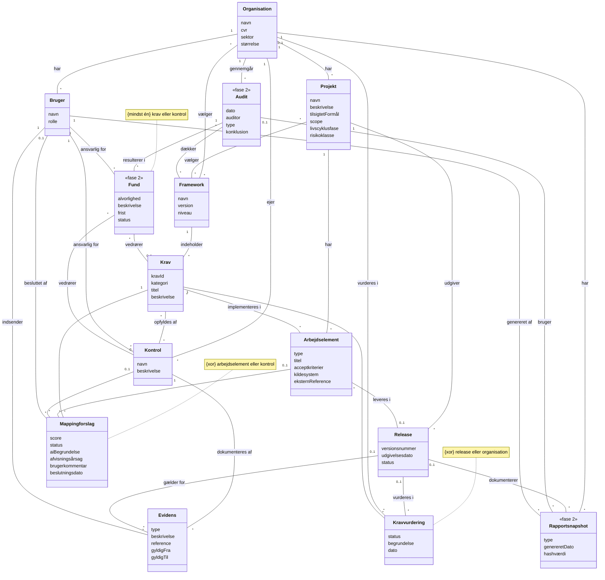

# Compliance-tracker – Domænemodel

Senest opdateret: 2026-10-18

## Formål

Domænemodellen beskriver de begreber, compliance-trackeren skal holde styr på, og hvordan de hænger sammen. Den er teknologineutral: ingen datatyper, metoder eller navigationsretning. Det kommer i klassediagrammet.

Trackeren svarer på spørgsmålet *"overholder vi reglerne, og kan vi bevise det?"*. Den svarer ikke på *"hvad skal vi bygge?"*; det er udviklernes ansvar og bor i deres eget værktøj.

Se også [beslutningsloggen](beslutningslog.md) og [udvidelser i fase 2–4](roadmap.md).

## Diagram

Begreber markeret med «fase 2» er med i modellen, så strukturen er klar til dem, men bygges ikke i første fase.

## Begreber

| Begreb | Betydning | Fase |
|---|---|---|
| Organisation | Virksomheden, der bruger trackeren. Sektor og størrelse afgør bl.a., om NIS2 er relevant. | 1 |
| Bruger | En person i organisationen med en rolle. Kan være ansvarlig for kontroller og indsende evidens. | 1 |
| Projekt | Et produkt, der skal overholde regler. Tilsigtet formål og scope afgør, hvilke krav der gælder, og er kontekst for AI'en. | 1 |
| Release | En konkret version af produktet. CRA tænker i versioner, så evidens og vurderinger kan knyttes hertil. | 1 |
| Framework | Et regelsæt, fx CRA, ISO 27001 eller AI Act. Niveau angiver, om det gælder organisationen eller et projekt. | 1 |
| Krav | Ét krav fra et framework, fx et Annex I-krav i CRA. Kategori afspejler frameworkets egen struktur. | 1 |
| Kontrol | Organisationens eget tiltag, der opfylder et eller flere krav. Én kontrol kan dække krav fra flere frameworks. | 1 |
| Kravvurdering | Status for ét krav, fx opfyldt, delvist, ikke opfyldt eller ikke relevant, med begrundelse. | 1 |
| Evidens | Bevis for, at en kontrol virker: dokument, scanningsresultat, link til PR osv. Har gyldighedsperiode. | 1 |
| Arbejdselement | En henvisning til en user story, use case eller opgave i et eksternt system. Trackeren ejer den ikke. | 1 |
| Mappingforslag | AI'ens forslag til en kobling mellem et krav og et arbejdselement eller en kontrol. Skal godkendes af et menneske. | 1 |
| Audit | En intern eller ekstern gennemgang. | 2 |
| Fund | En afvigelse fundet ved en audit, med alvorlighed, frist og ansvarlig. | 2 |
| Rapportsnapshot | En låst, afleveret rapport. Hashværdien beviser, at den ikke er ændret. | 2 |

## Regler

Disse regler kan ikke udtrykkes med multipliciteter alene. De vises som noter i diagrammet og bliver til validering og unit tests i koden.

1. **Mappingforslag:** peger på præcis ét af følgende: et arbejdselement eller en kontrol.
2. **Kravvurdering:** hører til præcis ét af følgende: en release (projektframeworks som CRA) eller organisationen (organisationsframeworks som ISO 27001).
3. **Fund:** vedrører mindst ét krav eller én kontrol.
4. **Framework og krav** er fælles referencedata. Organisationer og projekter vælger dem, men ejer dem ikke.
5. **Evidens** knyttes altid til en kontrol og kan desuden knyttes til en release, når den kun gælder en bestemt version (fx en SBOM).

## Ændret ved slutgennemgangen

Tre små huller blev lukket, før modellen blev låst for fase 1:

- **Kravvurdering på organisationsniveau.** Før kunne krav kun vurderes per release. Men ISO 27001 gælder hele organisationen, ikke en version, så en vurdering kan nu også høre til organisationen (regel 2).
- **`kategori` på Krav.** Frameworks har en indre struktur (temaer i ISO 27001 Annex A, kapitler i ASVS, dele af CRA Annex I). Kategorien gør det muligt at gruppere og filtrere.
- **`reference` på Evidens.** Selve beviset skal kunne findes: et link, en filsti eller et dokument-id.
