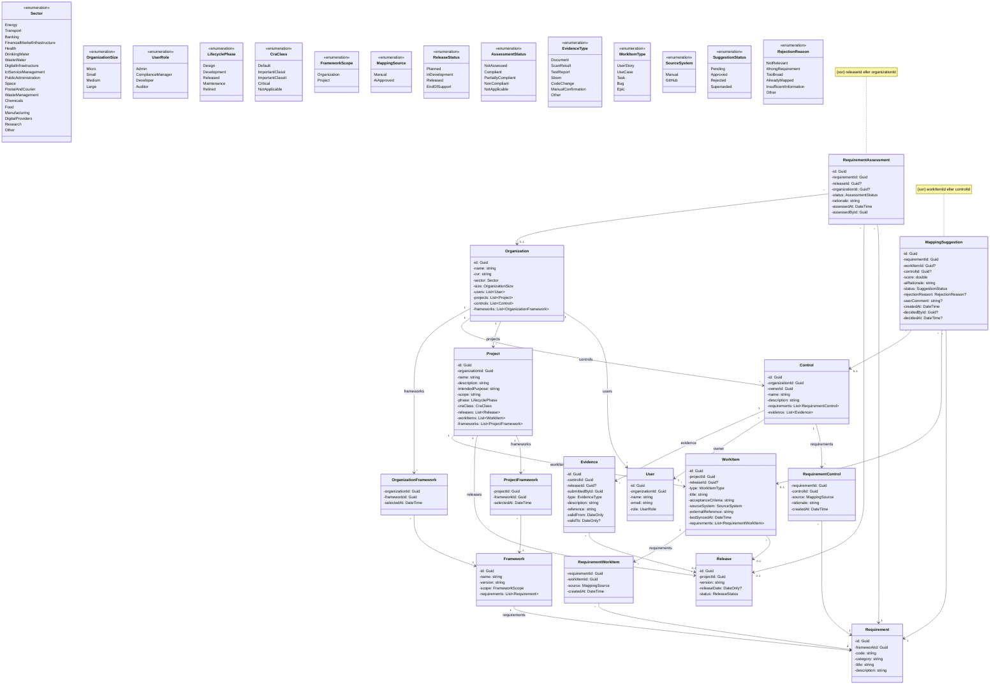

# Compliance-tracker – Klassediagram

Senest opdateret: 2026-10-19

Klassediagrammet bygger på [domænemodellen](domaenemodel.md) og viser modellagets klasser med attributter, datatyper og associationer. **Metoder tilføjes løbende**, når en user story kræver dem, og opdateres i samme pull request som koden. Reglerne, som metoderne skal håndhæve, står i domænemodellen.

Koden er på engelsk; se ordlisten nederst.

## Notation

| Tegn | Betydning | I C# |
|---|---|---|
| `-` | privat | `private` felt (eller property med `private set`) |
| `+` | offentlig | `public` |
| `Type?` | kan være tom | nullable type |

## Diagram

## Designvalg

- **Koblingsklasser med data.** `RequirementControl` og `RequirementWorkItem` registrerer via `MappingSource`, om koblingen er lavet manuelt eller via et godkendt AI-forslag.
- **Vurderinger ændres ikke.** En ny `RequirementAssessment` oprettes i stedet, og den seneste er gældende. Det giver historik til en auditor.
- **Enums gemmes som tekst** i databasen (`.HasConversion<string>()`), så nye værdier ikke forskyder eksisterende data.
- **`SourceSystem` indeholder kun det, der virker.** Azure DevOps, Jira og Internal tilføjes, når adapterne findes.
- **Integration** (`IWorkItemSource` og adaptere) tilføjes, når den første story om GitHub-integration tages ind.

## Ordliste

| Domænemodel (dansk) | Kode (engelsk) |
|---|---|
| Organisation | Organization |
| Bruger | User |
| Projekt | Project |
| Release | Release |
| Framework | Framework |
| Krav | Requirement |
| Kontrol | Control |
| Kravvurdering | RequirementAssessment |
| Evidens | Evidence |
| Arbejdselement | WorkItem |
| Mappingforslag | MappingSuggestion |
| Tilsigtet formål | IntendedPurpose |
| Kildesystem | SourceSystem |
