# Compliance-tracker – Klassediagram

Senest opdateret: 2026-10-28

Klassediagrammet bygger på [domænemodellen](domaenemodel.md) og viser modellagets klasser med attributter, datatyper og associationer. **Metoder tilføjes løbende**, når en user story kræver dem, og opdateres i samme pull request som koden. Reglerne, som metoderne skal håndhæve, står i domænemodellen.

Koden er på engelsk; se ordlisten nederst.

## Notation

| Tegn | Betydning | I C# |
|---|---|---|
| `-` | privat | `private` felt (eller property med `private set`) |
| `+` | offentlig | `public` |
| `Type?` | kan være tom | nullable type |
| `$` | statisk | `static` metode |
| `-->` | har et felt af typen | felt eller property |
| `..>` | bruger typen | parameter, returtype eller lokal variabel |

## Diagram

```mermaid
classDiagram
  direction TB

  %% ================= Organisation og brugere =================
  class Organization {
    -id: Guid
    -name: string
    -cvr: string
    -sector: Sector
    -size: OrganizationSize
    -users: List~User~
    -projects: List~Project~
    -controls: List~Control~
    -frameworks: List~OrganizationFramework~
    +Create(name: string, cvr: string, sector: Sector?, size: OrganizationSize?, creator: UserIdentity)$ Organization
  }
  class User {
    -id: Guid
    -organizationId: Guid
    -externalId: string
    -name: string
    -email: string
    -role: UserRole
  }
  class UserIdentity {
    <<record>>
    +ExternalId: string
    +Name: string
    +Email: string
  }

  %% ================= Services og repositories =================
  class OrganizationService {
    -organizations: IOrganizationRepository
    -activityLog: IActivityLogRepository
    -unitOfWork: IUnitOfWork
    -clock: TimeProvider
    +CreateAsync(name: string, cvr: string, sector: Sector?, size: OrganizationSize?, creator: UserIdentity) Task~Organization~
  }
  class UserActivityService {
    -organizations: IOrganizationRepository
    -activityLog: IActivityLogRepository
    -unitOfWork: IUnitOfWork
    -clock: TimeProvider
    +RecordSignInAsync(externalId: string) Task
    +RecordSignOutAsync(externalId: string) Task
  }
  class FrameworkService {
    -frameworks: IFrameworkRepository
    -organizations: IOrganizationRepository
    -activityLog: IActivityLogRepository
    -unitOfWork: IUnitOfWork
    -clock: TimeProvider
    +AddAsync(userExternalId: string, name: string, fileName: string, content: byte[]) Task~Framework~
    -projects: IProjectRepository
    +UploadVersionAsync(userExternalId: string, frameworkId: Guid, fileName: string, content: byte[], moveProjectIds: Guid[]?) Task~FrameworkVersion~
    +EnableBuiltInAsync(userExternalId: string, frameworkId: Guid) Task
    +DisableBuiltInAsync(userExternalId: string, frameworkId: Guid) Task
  }
  class IFrameworkRepository {
    <<interface>>
    +NameExistsAsync(organizationId: Guid, name: string) Task~bool~
    +AddAsync(framework: Framework) Task
    +AddDocumentAsync(frameworkVersionId: Guid, content: byte[]) Task
    +GetAsync(organizationId: Guid, frameworkId: Guid) Task~Framework?~
    +ListAsync(organizationId: Guid) Task~IReadOnlyList~Framework~~
    +GetAvailableAsync(organizationId: Guid, frameworkId: Guid) Task~Framework?~
    +GetDocumentAsync(organizationId: Guid, frameworkVersionId: Guid) Task
    +ListBuiltInAsync() Task~IReadOnlyList~Framework~~
    +GetBuiltInAsync(frameworkId: Guid) Task~Framework?~
    +GetActiveSelectionAsync(organizationId: Guid, frameworkVersionId: Guid) Task~OrganizationFramework?~
    +AddSelectionAsync(selection: OrganizationFramework) Task
  }
  class ProjectService {
    -projects: IProjectRepository
    -frameworks: IFrameworkRepository
    -organizations: IOrganizationRepository
    -activityLog: IActivityLogRepository
    -unitOfWork: IUnitOfWork
    -clock: TimeProvider
    +CreateAsync(userExternalId: string, name: string, description: string?, intendedPurpose: string, scope: string?, phase: LifecyclePhase, frameworkIds: Guid[]?) Task~Project~
    +AddFrameworkAsync(userExternalId: string, projectId: Guid, frameworkId: Guid, frameworkVersionId: Guid?) Task
    +UseNewestVersionAsync(userExternalId: string, projectId: Guid, frameworkId: Guid) Task
    +RemoveFrameworkAsync(userExternalId: string, projectId: Guid, frameworkId: Guid) Task
  }
  class IProjectRepository {
    <<interface>>
    +NameExistsAsync(organizationId: Guid, name: string) Task~bool~
    +AddAsync(project: Project) Task
    +GetAsync(organizationId: Guid, projectId: Guid) Task~Project?~
    +ListAsync(organizationId: Guid) Task~IReadOnlyList~Project~~
    +ListUsingFrameworkAsync(organizationId: Guid, frameworkId: Guid) Task~IReadOnlyList~Project~~
  }
  class IOrganizationRepository {
    <<interface>>
    +CvrExistsAsync(cvr: string) Task~bool~
    +AddAsync(organization: Organization) Task
    +GetByIdAsync(id: Guid) Task~Organization?~
    +GetByMemberAsync(externalId: string) Task~Organization?~
  }
  class IActivityLogRepository {
    <<interface>>
    +AppendAsync(entry: ActivityLogEntry) Task
  }
  class IUnitOfWork {
    <<interface>>
    +SaveChangesAsync() Task
  }

  %% ================= Projekt og releases =================
  class Project {
    -id: Guid
    -organizationId: Guid
    -name: string
    -description: string
    -intendedPurpose: string
    -scope: string
    -phase: LifecyclePhase
    -craClass: CraClass
    -releases: List~Release~
    -workItems: List~WorkItem~
    -frameworks: List~ProjectFramework~
    +Frameworks: IEnumerable~ProjectFramework~
    +Create(organizationId: Guid, name: string, description: string?, intendedPurpose: string, scope: string?, phase: LifecyclePhase)$ Project
    +FrameworkInUse(frameworkId: Guid) ProjectFramework?
    +UseFramework(framework: Framework, version: FrameworkVersion, userId: Guid, at: DateTime) ProjectFramework
    +ChangeFrameworkVersion(framework: Framework, version: FrameworkVersion, userId: Guid, at: DateTime) bool
    +RemoveFramework(framework: Framework, userId: Guid, at: DateTime)
  }
  class Release {
    -id: Guid
    -projectId: Guid
    -version: string
    -releaseDate: DateOnly?
    -status: ReleaseStatus
  }

  %% ================= Frameworks og krav =================
  class Framework {
    -id: Guid
    -ownerOrganizationId: Guid?
    -name: string
    -scope: FrameworkScope
    -versions: List~FrameworkVersion~
    +CurrentVersion: FrameworkVersion
    +IsBuiltIn: bool
    +Create(organizationId: Guid, name: string, file: CatalogFile, uploadedById: Guid, uploadedAt: DateTime)$ Framework
    +AddVersion(file: CatalogFile, uploadedById: Guid, uploadedAt: DateTime) FrameworkVersion
  }
  class FrameworkVersion {
    -id: Guid
    -frameworkId: Guid
    -number: int
    -fileName: string
    -sizeInBytes: long
    -sha256: string
    -uploadedById: Guid?
    -uploadedAt: DateTime
    -source: CatalogSource
    -sourceReference: string?
    -status: CatalogStatus
    -activatedAt: DateTime?
    -requirements: List~Requirement~
  }
  class CatalogFile {
    <<value object>>
    +FileName: string
    +Content: byte[]
    +Sha256: string
    +Create(fileName: string, content: byte[])$ CatalogFile
  }
  class Requirement {
    -id: Guid
    -frameworkVersionId: Guid
    -code: string
    -category: string
    -title: string
    -description: string
  }
  class OrganizationFramework {
    -id: Guid
    -organizationId: Guid
    -frameworkVersionId: Guid
    -enabledAt: DateTime
    -enabledById: Guid
    -disabledAt: DateTime?
    -disabledById: Guid?
    +IsActive: bool
    +Enable(organizationId: Guid, frameworkVersionId: Guid, enabledById: Guid, enabledAt: DateTime)$ OrganizationFramework
    +Disable(disabledById: Guid, disabledAt: DateTime)
  }
  class ProjectFramework {
    -id: Guid
    -projectId: Guid
    -frameworkId: Guid
    -frameworkVersionId: Guid
    -addedAt: DateTime
    -addedById: Guid
    -removedAt: DateTime?
    -removedById: Guid?
    +IsActive: bool
  }

  %% ================= Kontroller og evidens =================
  class Control {
    -id: Guid
    -organizationId: Guid
    -ownerId: Guid
    -name: string
    -description: string
    -requirements: List~RequirementControl~
    -evidence: List~Evidence~
  }
  class RequirementControl {
    -requirementId: Guid
    -controlId: Guid
    -source: MappingSource
    -rationale: string
    -createdAt: DateTime
  }
  class Evidence {
    -id: Guid
    -controlId: Guid
    -releaseId: Guid?
    -submittedById: Guid
    -type: EvidenceType
    -description: string
    -reference: string
    -validFrom: DateOnly
    -validTo: DateOnly?
  }

  %% ================= Vurderinger =================
  class RequirementAssessment {
    -id: Guid
    -requirementId: Guid
    -releaseId: Guid?
    -organizationId: Guid?
    -status: AssessmentStatus
    -rationale: string
    -assessedAt: DateTime
    -assessedById: Guid
  }

  %% ================= Arbejdselementer og AI =================
  class WorkItem {
    -id: Guid
    -projectId: Guid
    -releaseId: Guid?
    -type: WorkItemType
    -title: string
    -acceptanceCriteria: string
    -sourceSystem: SourceSystem
    -externalReference: string
    -lastSyncedAt: DateTime
    -requirements: List~RequirementWorkItem~
  }
  class RequirementWorkItem {
    -requirementId: Guid
    -workItemId: Guid
    -source: MappingSource
    -createdAt: DateTime
  }
  class MappingSuggestion {
    -id: Guid
    -requirementId: Guid
    -workItemId: Guid?
    -controlId: Guid?
    -score: double
    -aiRationale: string
    -status: SuggestionStatus
    -rejectionReason: RejectionReason?
    -userComment: string?
    -createdAt: DateTime
    -decidedById: Guid?
    -decidedAt: DateTime?
  }

  %% ================= Log =================
  class ActivityLogEntry {
    -id: Guid
    -organizationId: Guid
    -userId: Guid
    -action: ActivityAction
    -subjectId: Guid?
    -occurredAt: DateTime
  }

  %% ================= Enums =================
  class Sector {
    <<enumeration>>
    Energy
    Transport
    Banking
    FinancialMarketInfrastructure
    Health
    DrinkingWater
    WasteWater
    DigitalInfrastructure
    IctServiceManagement
    PublicAdministration
    Space
    PostalAndCourier
    WasteManagement
    Chemicals
    Food
    Manufacturing
    DigitalProviders
    Research
    Other
  }
  class OrganizationSize {
    <<enumeration>>
    Micro
    Small
    Medium
    Large
  }
  class UserRole {
    <<enumeration>>
    Admin
    ComplianceManager
    Developer
    Auditor
  }
  class LifecyclePhase {
    <<enumeration>>
    Planning
    Development
    Released
    EndOfSupport
  }
  class CraClass {
    <<enumeration>>
    Default
    ImportantClassI
    ImportantClassII
    Critical
    NotApplicable
  }
  class FrameworkScope {
    <<enumeration>>
    Organization
    Project
  }
  class CatalogSource {
    <<enumeration>>
    BuiltIn
    Imported
  }
  class CatalogStatus {
    <<enumeration>>
    Draft
    Active
    Retired
  }
  class ActivityAction {
    <<enumeration>>
    OrganizationCreated
    UserSignedIn
    UserSignedOut
    CatalogImported
    CatalogActivated
    FrameworkEnabled
    FrameworkDisabled
    ProjectFrameworkAdded
    ProjectFrameworkRemoved
    ProjectFrameworkVersionChanged
  }
  class MappingSource {
    <<enumeration>>
    Manual
    AiApproved
  }
  class ReleaseStatus {
    <<enumeration>>
    Planned
    InDevelopment
    Released
    EndOfSupport
  }
  class AssessmentStatus {
    <<enumeration>>
    NotAssessed
    Compliant
    PartiallyCompliant
    NonCompliant
    NotApplicable
  }
  class EvidenceType {
    <<enumeration>>
    Document
    ScanResult
    TestReport
    Sbom
    CodeChange
    ManualConfirmation
    Other
  }
  class WorkItemType {
    <<enumeration>>
    UserStory
    UseCase
    Task
    Bug
    Epic
  }
  class SourceSystem {
    <<enumeration>>
    Manual
    GitHub
  }
  class SuggestionStatus {
    <<enumeration>>
    Pending
    Approved
    Rejected
    Superseded
  }
  class RejectionReason {
    <<enumeration>>
    NotRelevant
    WrongRequirement
    TooBroad
    AlreadyMapped
    InsufficientInformation
    Other
  }

  %% ================= Associationer =================
  Organization "1" --> "*" User : users
  Organization "1" --> "*" Project : projects
  Organization "1" --> "*" Control : controls
  Organization "1" --> "*" OrganizationFramework : frameworks
  Framework "*" --> "0..1" Organization : owner
  OrganizationFramework "*" --> "1" FrameworkVersion
  Project "1" --> "*" ProjectFramework : frameworks
  ProjectFramework "*" --> "1" FrameworkVersion
  Project "1" --> "*" Release : releases
  Project "1" --> "*" WorkItem : workItems
  WorkItem "*" --> "0..1" Release
  Framework "1" --> "*" FrameworkVersion : versions
  FrameworkVersion "1" --> "*" Requirement : requirements
  Control "1" --> "*" RequirementControl : requirements
  RequirementControl "*" --> "1" Requirement
  Control "*" --> "1" User : owner
  Control "1" --> "*" Evidence : evidence
  Evidence "*" --> "0..1" Release
  WorkItem "1" --> "*" RequirementWorkItem : requirements
  RequirementWorkItem "*" --> "1" Requirement
  RequirementAssessment "*" --> "1" Requirement
  RequirementAssessment "*" --> "0..1" Release
  RequirementAssessment "*" --> "0..1" Organization
  MappingSuggestion "*" --> "1" Requirement
  MappingSuggestion "*" --> "0..1" WorkItem
  MappingSuggestion "*" --> "0..1" Control
  ActivityLogEntry "*" --> "1" Organization
  ActivityLogEntry "*" --> "1" User
  OrganizationService --> IOrganizationRepository : organizations
  OrganizationService --> IActivityLogRepository : activityLog
  OrganizationService --> IUnitOfWork : unitOfWork
  OrganizationService ..> UserIdentity : creator
  UserActivityService --> IOrganizationRepository : organizations
  UserActivityService --> IActivityLogRepository : activityLog
  UserActivityService --> IUnitOfWork : unitOfWork
  FrameworkService --> IFrameworkRepository : frameworks
  FrameworkService --> IOrganizationRepository : organizations
  FrameworkService --> IActivityLogRepository : activityLog
  FrameworkService --> IUnitOfWork : unitOfWork
  FrameworkService ..> CatalogFile : validerer
  ProjectService --> IProjectRepository : projects
  ProjectService --> IOrganizationRepository : organizations
  ProjectService --> IActivityLogRepository : activityLog
  ProjectService --> IUnitOfWork : unitOfWork
  ProjectService ..> Project : opretter
  IProjectRepository ..> Project
  ProjectService --> IFrameworkRepository : frameworks
  FrameworkService --> IProjectRepository : projects
  IFrameworkRepository ..> Framework
  IFrameworkRepository ..> OrganizationFramework
  Framework ..> CatalogFile
  OrganizationService ..> Organization : opretter
  IOrganizationRepository ..> Organization
  IActivityLogRepository ..> ActivityLogEntry

  note for MappingSuggestion "{xor} workItemId eller controlId"
  note for RequirementAssessment "{xor} releaseId eller organizationId"
  note for FrameworkVersion "BuiltIn: ownerOrganizationId = null / Imported: ownerOrganizationId påkrævet"
```

## Designvalg

- **Koblingsklasser med data.** `RequirementControl` og `RequirementWorkItem` registrerer via `MappingSource`, om koblingen er lavet manuelt eller via et godkendt AI-forslag.
- **Vurderinger ændres ikke.** En ny `RequirementAssessment` oprettes i stedet, og den seneste er gældende. Det giver historik til en auditor.
- **Frameworkversioner låses ved aktivering.** Når `status` er `Active`, kan `requirements` ikke ændres. Så kan en mapping nøjes med at pege på et `Requirement`, fordi teksten bag aldrig ændrer sig. En rettelse er en ny `FrameworkVersion`.
- **`OrganizationFramework` og `ProjectFramework` peger på en version**, ikke et framework. Klassenavnene er beholdt, fordi de stadig beskriver "hvilket framework er valgt"; versionen er detaljen.
- **`Framework` indeholder ingen kravtekst.** Den er kun navn og niveau, så den kan seedes som fælles referencedata uden ophavsretlige problemer.
- **`ActivityLogEntry` er append-only.** Ingen opdatering eller sletning, heller ikke for Admin.
- **Enums gemmes som tekst** i databasen (`.HasConversion<string>()`), så nye værdier ikke forskyder eksisterende data.
- **`SourceSystem` indeholder kun det, der virker.** Azure DevOps, Jira og Internal tilføjes, når adapterne findes.
- **Integration** (`IWorkItemSource` og adaptere) tilføjes, når den første story om GitHub-integration tages ind.
- **`Organization.Create` er en statisk fabriksmetode** i stedet for en offentlig constructor, så en organisation ikke kan oprettes, uden at reglerne er tjekket. (US-001)
- **Validering deles i to.** Regler for de enkelte felter (navn, CVR-format, sektor) ligger som guard clauses i `Organization.Create`. Regler, der kræver kendskab til andre organisationer (unikt CVR), ligger i `OrganizationService`. (US-001)
- **Repositories er interfaces i Application-laget.** De beskriver kun, hvad der skal kunne gemmes og slås op. Implementeringen ligger i Infrastructure (EF Core og PostgreSQL), og testene har en in-memory-udgave. (US-001, US-002)
- **`IActivityLogRepository` har kun `AppendAsync`.** Der findes ingen metode til at ændre eller slette logposter, så append-only håndhæves af selve interfacet. (US-001)
- **Repositories gemmer ikke selv.** De registrerer kun ændringer. `IUnitOfWork.SaveChangesAsync` gemmer det hele i én transaktion, så en organisation og logposten for dens oprettelse enten gemmes sammen eller slet ikke. (US-002)
- **Databasens nøgler holdes ude af domænet.** `User.organizationId` findes kun som fremmednøgle i databasen, og `ActivityLogEntry` får et fortløbende id, som kun databasen kender (shadow properties). Domæneklasserne er derfor uændrede. (US-002)
- **Connection string ligger aldrig i repoet.** Den læses fra miljøvariablen `ConnectionStrings__ComplianceTracker`. Integrationstestene starter deres egen PostgreSQL-container med Testcontainers. (US-002)
- **Web-UI'et er en tynd skal.** `OrganizationsController` (ASP.NET Core MVC) oversætter kun mellem formularen og `OrganizationService`. Fejlbeskeder kommer fra `DomainException`, så reglerne kun findes ét sted. Web-laget er ikke med i diagrammet, fordi det ikke er en del af modellen. (US-003)
- **Formularer kræver antiforgery-token** (`[ValidateAntiForgeryToken]`), så kun formularer fra applikationen selv kan oprette data (ASVS V3.5.1). (US-003)
- **Brugere genkendes på `externalId`**, Keycloaks `sub`-claim, og aldrig på navn eller e-mail, som kan ændres eller deles (ASVS V10.5.2). Kolonnen har et unikt index. (US-004)
- **`UserIdentity` er den indloggede persons identitet**, som Web-laget laver ud fra login-cookien og giver videre til Application og Domain. Domænet ved ikke, at den kommer fra Keycloak. (US-004)
- **Én organisation pr. bruger.** `OrganizationService` afviser en anden organisation for samme bruger, og en bruger kan kun se sin egen (andre giver 404). (US-004)
- **Log ind og log ud logges af `UserActivityService`.** Første login logges ikke, fordi brugeren endnu ikke har en organisation; oprettelsen logges i stedet som `OrganizationCreated`. (US-004)
- **Frameworks uploades som PDF.** En version er et dokument med versionsnummer, filnavn, størrelse og SHA-256-fingeraftryk. Kravene trækkes først ud af PDF'en i US-007; indtil da er `requirements`, `status` og `activatedAt` ikke i brug. (US-005)
- **`CatalogFile` er et value object**, som kun kan oprettes med en gyldig PDF på højst 20 MB og et renset filnavn. Reglerne for filer findes derfor ét sted (ASVS V5.2.1, V5.2.2, V5.3.2). (US-005)
- **Et framework har altid mindst én version**, og versionsnumrene tælles af `Framework` selv. En version ændres aldrig; en ny upload er en ny version, og `CurrentVersion` er den nyeste. (US-005)
- **PDF'en gemmes i sin egen tabel** (`CatalogDocuments` i Infrastructure), så lister over frameworks ikke henter filindholdet. Domænet kender kun fingeraftrykket. (US-005)
- **Alle opslag filtrerer på organisationen.** `IFrameworkRepository` tager altid `organizationId`, så en bruger aldrig kan hente en anden organisations filer, heller ikke ved at gætte et id (ASVS V8.2.2). (US-005)
- **Logposter kan pege på det, de handler om** via `subjectId`, fx frameworkversionen ved `CatalogImported`. (US-005)
- **Et projekt kræver navn og tilsigtet formål.** Det tilsigtede formål afgør, hvilke krav der gælder (CRA Annex VII, punkt 1(a)). Beskrivelse og scope er valgfri, og fasen starter som `Planning`. Navnet er unikt i organisationen uden hensyn til store og små bogstaver; det tjekkes i `ProjectService`. (US-008)
- **`LifecyclePhase` dækker hele produktets levetid**: `Planning`, `Development`, `Released` og `EndOfSupport`. De erstatter de tidligere foreslåede `Design`, `Maintenance` og `Retired` (B19). (US-008)
- **Indbyggede frameworks har ingen ejer.** CRA og AI Act seedes af en migration med faste id'er, `ownerOrganizationId = null`, én version uden fil og uploader og et link til den officielle tekst på EUR-Lex i `sourceReference`. Kravene seedes ikke endnu (B20). (US-006)
- **Indbyggede frameworks kan ikke ændres.** `Framework.AddVersion` afviser dem (`IsBuiltIn`), og `IFrameworkRepository.GetAsync` finder kun organisationens egne frameworks, så upload af en ny version giver en fejl. (US-006)
- **At slå et framework til er en `OrganizationFramework`-række.** Slås det fra, sættes `disabledAt`; rækken slettes aldrig, så historikken bevares, og slås det til igen, oprettes en ny række. Begge dele logges som `FrameworkEnabled`/`FrameworkDisabled` med versionen som `subjectId`. `ListAsync` viser organisationens egne frameworks og de indbyggede, der er slået til. (US-006)
- **Et projekt følger én version af hvert framework.** `Project` holder sine `ProjectFramework`-rækker og afviser en anden version af et framework, det allerede bruger. Databasen har samme regel som et unikt index på projekt og framework for aktive rækker. `frameworkId` gemmes ved siden af versionen, så reglen er nem at tjekke. (US-011)
- **Versionsskift og fjernelse bevarer historikken.** Et versionsskift sætter `removedAt` på den gamle række og opretter en ny; en fjernelse sætter kun `removedAt`. Rækker slettes aldrig. (US-011)
- **Projektet vælger blandt organisationens frameworks**: de uploadede og de indbyggede, der er slået til (`IFrameworkRepository.GetAvailableAsync`). Et indbygget framework kan ikke slås fra, mens projekter bruger det. (US-011)
- **En ny version flytter kun de valgte projekter.** `FrameworkService.UploadVersionAsync` tager de projekter, brugeren har krydset af, og gemmer versionen og versionsskiftene i én transaktion. De andre projekter beholder deres version. (US-011)
- **Logposter om projektets frameworks peger på projektet** (`subjectId`). Framework og versioner står i `ProjectFramework`-rækkerne med samme tidspunkt og bruger. (US-011)
- **Services læser tiden fra `TimeProvider`**, ikke fra `DateTime.UtcNow`. Appen bruger systemets ur; testene sætter et fast tidspunkt, så de kan tjekke, at hver logpost har præcis det tidspunkt, handlingen skete (B22). (US-016)
- **Størrelse er påkrævet ligesom sektor.** `Organization.Create` tager `OrganizationSize?` og afviser `null` med "Size is required"; formularen starter med "-- Choose size --". (US-016)
- **Projekter følger samme adgangsregel som frameworks**: `IProjectRepository` tager altid `organizationId`, og andre organisationers projekter giver 404. Oprettelse logges som `ProjectCreated` med projektet som `subjectId`. (US-008)

## Ordliste

| Domænemodel (dansk) | Kode (engelsk) |
|---|---|
| Organisation | Organization |
| Bruger | User |
| Projekt | Project |
| Release | Release |
| Framework | Framework |
| Frameworkversion | FrameworkVersion |
| Krav | Requirement |
| Kontrol | Control |
| Kravvurdering | RequirementAssessment |
| Evidens | Evidence |
| Arbejdselement | WorkItem |
| Mappingforslag | MappingSuggestion |
| Logpost | ActivityLogEntry |
| Tilsigtet formål | IntendedPurpose |
| Kildesystem | SourceSystem |
| Indbygget / importeret | BuiltIn / Imported |
